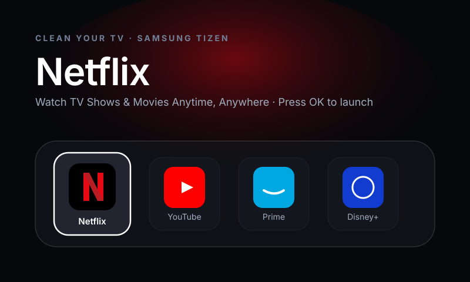
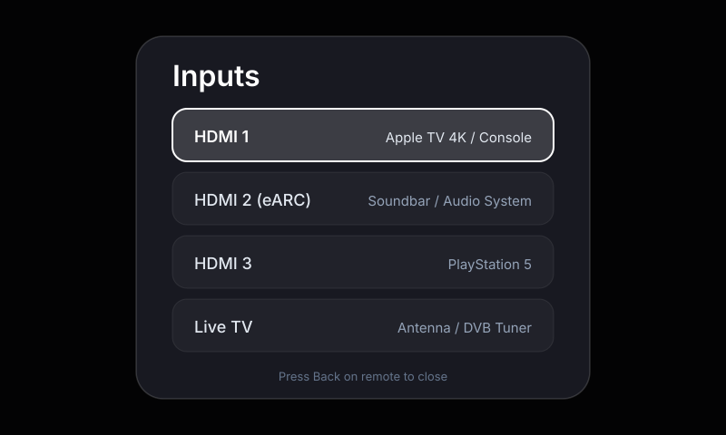
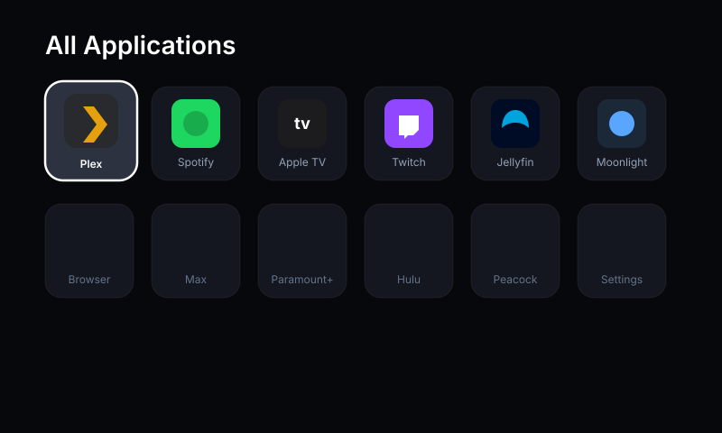
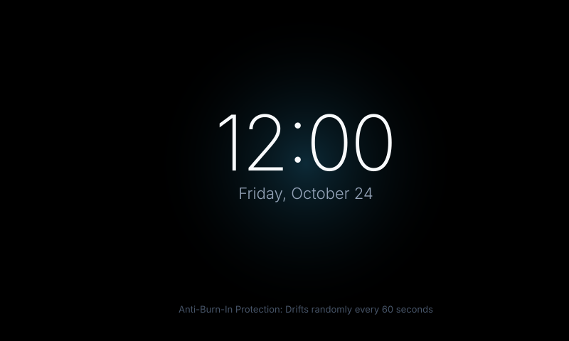

<p align="center">
  <a href="https://github.com/smartjaganrao/cleanyourtv-samsung/pulls?q=is%3Amerged"></a>
  <a href="https://github.com/smartjaganrao/cleanyourtv-samsung/network/members"></a>
  <a href="https://github.com/smartjaganrao/cleanyourtv-samsung/graphs/contributors"></a>
  <a href="https://img.shields.io/badge/Tizen%20OS-2.4%20--%209.0%2B-38bdf8?style=flat&labelColor=15181e"></a>
  <a href="https://img.shields.io/badge/Resolution-4K%20HDR%2060fps-a855f7?style=flat&labelColor=15181e"></a>
  <a href="https://img.shields.io/badge/Root%20Required-NO-10b981?style=flat&labelColor=15181e"></a>
  <a href="LICENSE"></a>
</p>

<p align="center">
  
</p>

**Debloat any Samsung Smart TV over Wi-Fi, silence sponsored ads & telemetry, and get a blazing-fast, Apple TV-style home screen.**

Adapted from the viral project [Gathin23/cleanyourtv](https://github.com/Gathin23/cleanyourtv) specifically for **Samsung Smart TVs running Tizen OS** (Neo QLED, OLED, The Frame, QLED, UHD Crystal, Series 6/7/8/9, 2016–2026+).

---

## How it works

While Android TVs use ADB (`adb shell pm disable-user`), **Samsung Smart TVs run Samsung Tizen OS**, which is locked down against shell package removal. Retail Samsung TVs force unskippable video ads in Samsung TV Plus, sponsored banner rows in Smart Hub, and continuous ACR (Automated Content Recognition) tracking.

**This project solves it cleanly using native Tizen architecture:**

| Step | What happens |
|---|---|
| **1. Back&nbsp;up** | The list of installed apps, device metadata, and network state with `tools/backup.py`. |
| **2. Silence Ads** | Block Samsung ACR viewing tracking and sponsored ad engines (`samsungads.com`, `samsungacr.com`, `gpm.samsungqbe.com`) at the DNS level, and turn off in-TV tracking toggles. |
| **3. Install** | A lightweight native Tizen Web Application (`.wgt`), sideloaded over Wi-Fi via Developer Mode and SDB (Smart Development Bridge). |
| **4. Bypass Smart Hub** | Configure Samsung's built-in power-on behavior (`Autorun Last App = ON` + `Autorun Smart Hub = OFF`) so the TV powers on directly into CleanYourTV. |

**No root, no cable, zero brick risk, and 100% reversible in one click.**

---

## Quick start

| You have | Do this |
|---|---|
| **A computer + AI Assistant** | Use [`PROMPT.md`](PROMPT.md) with Gemini CLI, Claude Code, or Codex. It guides the backup, discovery, sideload, and auto-boot setup interactively. |
| **Standard Terminal / Shell** | Connect over Wi-Fi, package the launcher, and install in under two minutes with the included Python tools. |

### 3-Step Setup

| Where | What to do |
|---|---|
| **1. On your Samsung TV** | Open **Apps** → on the remote, press `1` `2` `3` `4` `5` → turn **Developer Mode** ON → enter your computer's local IP in **Host PC IP** → hold the remote's **Power** button for 3 seconds to restart the TV. |
| **2. On your computer** | Run the setup commands below: probe the TV, pair remote access, and install the `.wgt` launcher over Wi-Fi. |
| **3. Bypass Smart Hub** | On the TV: `Settings → General → Smart Features` → set **Autorun Smart Hub = OFF** and **Autorun Last App = ON**. |

```bash
# Clone the repository
git clone https://github.com/smartjaganrao/cleanyourtv-samsung.git
cd cleanyourtv-samsung

# 1. Probe TV on Wi-Fi (checks port 8001 and Tizen SDB port 26101)
python3 tools/samsung_tv.py --probe <TV_IP>

# 2. Pair remote authentication (click 'Allow' on your TV screen)
python3 tools/samsung_tv.py --pair <TV_IP>

# 3. Package and sideload the launcher to your TV
python3 tools/package_wgt.py
python3 tools/sdb_install.py <TV_IP>

# 4. Check & block Samsung ad/telemetry servers
python3 tools/debloat_dns.py --check
```

*Detailed developer mode walkthrough: [docs/DEVELOPER_MODE.md](docs/DEVELOPER_MODE.md)*  
*Auto-boot configuration guide: [docs/BYPASS_SMART_HUB.md](docs/BYPASS_SMART_HUB.md)*

---

## What you get

A home screen that looks and feels like an Apple TV and gets completely out of your way:

| Part | What it looks like |
|---|---|
| **A pitch-black OLED home** | Deep black (`#07080b`) aesthetic that turns off black pixels on OLED panels, eliminates visual noise, and saves power. |
| **An Apple TV glass dock** | A rounded frosted-glass band holding your 4 to 6 favorite apps (Netflix, YouTube, Prime, Plex, Disney+, HDMI consoles). |
| **A top shelf** | Names the focused app in large 72px [Outfit](https://fonts.google.com/specimen/Outfit) typography, with an ambient radial glow in a color sampled from the app's brand artwork. |
| **The rest of your apps in a grid** | Slides up smoothly when you press **Down** on your remote to reveal all installed apps in a 6-column grid. |
| **One floating glass highlight** | Springs from tile to tile with smooth physics. The focused tile gently zooms and lifts. |
| **Three frosted buttons** | Inputs (HDMI 1, HDMI 2 eARC, HDMI 3, HDMI 4, Live TV), Wi-Fi / Ethernet status, and Settings. |
| **A greeting, a thin clock and date** | In crisp Outfit typography, with matching anti-burn-in Clock screensaver that drifts every 60 seconds. |
| **Themes and customization** | Switch themes (OLED Pitch Black, Northern Aurora, Midnight Glass, Minimal Quiet) without rebuilding. |
| **Zero sponsored rows** | No sponsored banners, no forced video trailers, and no tracking. |

---

## Visual Showcase

| | |
|---|---|
|  |  |
| *Top shelf names focused app over ambient brand glow* | *Inputs modal: HDMI 1-4 with connection state, eARC, Live TV* |
|  |  |
| *The grid: 6-column smooth scrolling with glass highlight* | *OLED screensaver: drifts across screen to prevent burn-in* |

---

## Supported Samsung TVs

Works on **any Samsung Smart TV running Tizen OS** (2016 through 2026+):

| Lineup | Screen Type | Tizen OS | Supported Features |
|---|---|---|---|
| **Samsung Neo QLED** (QN900, QN800, QN95, QN90, QN85) | Mini-LED 8K / 4K | Tizen 6.5 – 9.0+ | Launcher, Auto-boot, 4K 60fps, Adblock |
| **Samsung OLED** (S95D, S90D, S95C, S90C, S95B) | QD-OLED / OLED 4K | Tizen 6.5 – 8.0+ | Pitch Black pixel-off mode, Anti-burn-in screensaver |
| **The Frame** (LS03D, LS03C, LS03B, LS03A) | Matte QLED 4K | Tizen 5.5 – 8.0+ | Auto-boot on wake; **Art Mode completely preserved** |
| **The Serif &amp; The Sero** | Lifestyle QLED | Tizen 5.5 – 7.0+ | Full launcher and horizontal/vertical support |
| **Samsung QLED** (Q80, Q70, Q60) | Quantum Dot LED | Tizen 5.0 – 8.0+ | SDB sideload, Auto-boot bypass, App grid |
| **Crystal UHD** (DU8000, CU8000, AU8000, TU8000) | Dynamic Crystal 4K | Tizen 5.0 – 8.0+ | **Major speedup** vs sluggish factory Smart Hub |
| **Smart Monitors** (M8, M7, M5) | Smart Display | Tizen 6.5 – 7.0+ | Productivity & streaming hub bypass |
| **Older Series 6 / 7 / 8 / 9** (2016–2019) | FHD / 4K UHD | Tizen 2.4 – 4.0 | Supported via legacy WebSocket (port 8001) |

Tested model profiles with debloat lists live in [`examples/`](examples/):
- [Samsung Neo QLED QN90D 2024](examples/samsung-neo-qled-qn90d-2024/)
- [Samsung The Frame LS03D 2024](examples/samsung-the-frame-ls03d-2024/)
- [Samsung OLED S90C 2023](examples/samsung-oled-s90c-2023/)
- [Samsung Crystal UHD CU8000 2023](examples/samsung-crystal-uhd-cu8000-2023/)
- [Samsung QLED Q60A 2021](examples/samsung-qled-q60a-2021/)

---

## Three things to know before you start

- ⚡ **Hold Power for 3 seconds to restart after Developer Mode:** Simply pressing the power button puts the TV into standby. You must hold it until the Samsung startup logo appears for port 26101 to open.
- 🛡️ **Zero risk of bricking:** Samsung TV firmware partitions are strictly read-only. CleanYourTV runs as an authorized user-space Tizen Web Application and uses native TV settings. Nothing is flashed or rooted.
- 🖼️ **The Frame's Art Mode stays untouched:** If you have The Frame, Art Mode continues working normally. When waking from Art Mode or turning the screen on, CleanYourTV opens instead of the ad-filled Smart Hub.

---

## Questions people ask

<details>
<summary><b>Is this safe? Can it brick my Samsung TV?</b></summary>

**Completely safe.** Nothing on your TV's firmware is rooted, flashed, or modified. The launcher is packaged as a standard W3C Tizen Web Application (`.wgt`), installed via the official Samsung Developer Mode API. If you ever change your mind, setting `Autorun Smart Hub` back to **ON** in TV settings restores the factory interface immediately.

</details>

<details>
<summary><b>What about Samsung firmware updates?</b></summary>

Samsung firmware updates arrive over-the-air as normal. Because CleanYourTV is installed in the user app partition, system firmware updates do not remove it. If a major firmware update resets your startup preferences, simply re-toggle `Autorun Last App = ON` in settings.

</details>

<details>
<summary><b>Won't my streaming apps break?</b></summary>

No. Streaming apps (Netflix, YouTube, Prime Video, Plex, Disney+, Apple TV, Spotify) still update automatically through the Samsung App Store. CleanYourTV launches them using Samsung's official `tizen.application.launch()` API.

</details>

<details>
<summary><b>Can I block ads inside apps too?</b></summary>

Yes, by pointing your TV's DNS in Network Settings to an ad-blocking DNS resolver such as [AdGuard DNS](https://adguard-dns.io) (`94.140.14.14`) or NextDNS, or adding [`blocklists/pihole-blocklist.txt`](blocklists/pihole-blocklist.txt) to your local Pi-hole. This stops tracking and in-app banners across all apps. (YouTube in-stream video ads are served from video streams and cannot be blocked via DNS alone; use TizenTube for ad-free YouTube).

</details>

<details>
<summary><b>Does AirPlay 2 and Cast still work?</b></summary>

Yes! Apple AirPlay 2 is built into Samsung TV's system firmware and continues to receive audio and video streaming from iPhones, iPads, and Macs seamlessly.

</details>

<details>
<summary><b>Can I do this remotely for family in another home?</b></summary>

Yes, over a private [Tailscale](https://tailscale.com) network subnet router or WireGuard VPN. As long as your computer can reach the TV's IP address on ports 8001/8002 and 26101, all tools work identically.

</details>

<details>
<summary><b>How do I completely uninstall if I sell my TV?</b></summary>

Run `python3 tools/restore.py <TV_IP>`, or simply hold the OK button on the "Clean Your TV" icon in your TV's Apps menu and select **Delete**. Turn `Autorun Smart Hub` back to ON. Your TV is 100% factory original.

</details>

---

## Repository Structure

```
cleanyourtv-samsung/
├── PROMPT.md                  # Guided prompt for AI coding assistants
├── README.md                  # Comprehensive documentation
├── config.json                # User configuration & dock preferences
├── cleanyourtv-samsung.wgt    # Ready-to-install Tizen widget package
├── launcher/                  # Native Tizen Web Application
│   ├── config.xml             # Tizen W3C Widget manifest & permissions
│   ├── index.html             # High-performance 4K interface
│   ├── css/
│   │   ├── style.css          # Glassmorphism, dock, ambient glow
│   │   └── fonts.css          # Typography & system font stack
│   ├── js/
│   │   ├── app.js             # Spatial D-pad navigation, clock, screensaver
│   │   ├── tizen-api.js       # Samsung Tizen API (launchApp, remote keys)
│   │   ├── mock-apps.js       # App catalog, 4K vector icons & colors
│   │   └── config.js          # Settings & theme manager
│   └── assets/
│       └── icon.png           # 512x512 launcher icon
├── tools/                     # Command-line tools
│   ├── samsung_tv.py          # Discovery, pairing, remote keys, app launch
│   ├── package_wgt.py         # Packages launcher into .wgt archive
│   ├── sdb_install.py         # SDB connector and package installer
│   ├── debloat_dns.py         # Verifies and exports DNS ad blocklists
│   ├── theme.py               # Theme switcher CLI
│   ├── backup.py              # Backs up TV state & installed apps
│   └── restore.py             # Reverts TV settings & uninstalls launcher
├── blocklists/                # Domain blocklists for Pi-hole & routers
│   ├── samsung-ads-telemetry.txt
│   └── pihole-blocklist.txt
├── examples/                  # Verified Samsung TV model debloat profiles
│   ├── samsung-neo-qled-qn90d-2024/
│   ├── samsung-the-frame-ls03d-2024/
│   ├── samsung-oled-s90c-2023/
│   ├── samsung-crystal-uhd-cu8000-2023/
│   └── samsung-qled-q60a-2021/
├── docs/                      # Technical guides & graphics
│   ├── DEVELOPER_MODE.md      # Samsung TV Developer Mode unlock guide
│   ├── BYPASS_SMART_HUB.md    # Auto-boot setup guide
│   ├── TIZEN_APP_IDS.md       # Reference list of Tizen App IDs
│   ├── TROUBLESHOOTING.md     # Common issues and solutions
│   ├── SHOWCASE.md            # Verified TV lineups and community themes
│   ├── ARCHITECTURE.md        # Technical architecture comparison
│   ├── card.svg               # Before & After hero showcase
│   ├── focus-shelf.svg        # Top shelf preview
│   ├── inputs-menu.svg        # Inputs modal preview
│   ├── clock-screensaver.svg  # Drift clock screensaver preview
│   └── app-grid.svg           # 6-column app grid preview
└── themes/                    # Visual themes (OLED black, aurora, midnight, minimal)
```

---

## Contributing

The most useful contribution is your Samsung TV's verified debloat profile and model code in [`examples/`](examples/), so the next person with your TV can set it up instantly. See [`CONTRIBUTING.md`](CONTRIBUTING.md) and [`AGENTS.md`](AGENTS.md).

---

## Legal & Disclaimer

- CleanYourTV Samsung Edition is an independent, community-driven open-source project. It is not affiliated with, endorsed by, or sponsored by Samsung Electronics Co., Ltd.
- Brand and product names (Samsung, Tizen, Neo QLED, The Frame, Smart Hub, Netflix, YouTube, etc.) are used solely to identify device compatibility and remain the trademarks of their respective owners.
- This project operates exclusively through official settings and developer bridges provided by the TV (`1-2-3-4-5` Developer Mode, Smart Development Bridge, and system auto-boot options). It does not flash firmware, bypass DRM, or modify protected hardware registers.

---

## License

MIT License. See [`LICENSE`](LICENSE).
