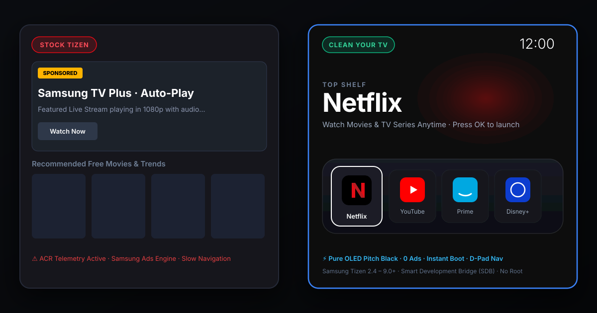
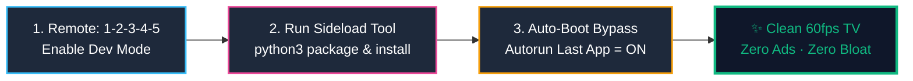
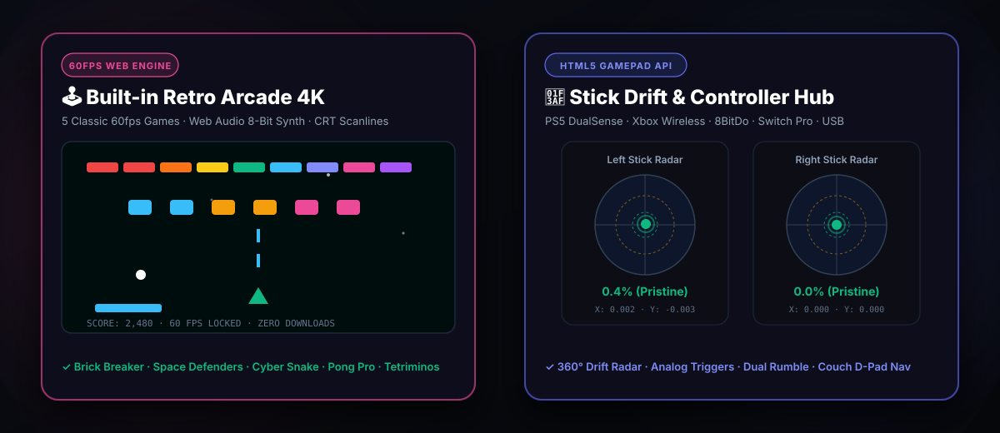
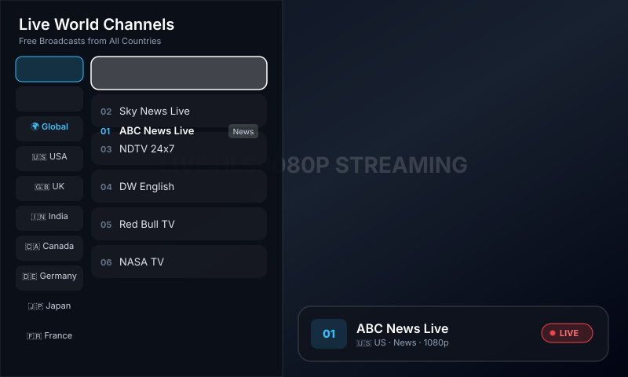

<div align="center">

# 📺 CleanHub TV (Samsung Edition)
### The Open-Source, Ad-Free, 60fps Replacement for Samsung Smart Hub

[](https://github.com/smartjaganrao/cleanyourtv-samsung/releases/latest)
[](#-retro-arcade-4k--gamepad-drift-hub)
[](docs/ADFREE_YOUTUBE.md)
[](docs/ART_MODE.md)
[](docs/LIVETV.md)
[](LICENSE)
[](https://github.com/smartjaganrao/cleanyourtv-samsung/stargazers)

<br>



<br>
<br>

**CleanHub TV** is the ultimate open-source alternative to Samsung's bloated Smart Hub. It replaces intrusive banner ads, sponsored video trailers, and system lag with a hardware-accelerated **Apple TV-style glass interface** running at a locked **60fps**.<br>
Includes **Built-in 60fps Retro Arcade**, **Zero-Latency Gamepad Stick Drift Radar**, **Ad-Free YouTube with SponsorBlock**, free **"The Frame" 4K Ambient Art Mode**, **350+ Free Live World IPTV Channels**, **1-Click Bedtime Sleep Timer**, **24/7 Lo-Fi Radio with OLED Screen-Off**, and **TV Speed Diagnostics**.

*Runs on any Samsung Smart TV running Tizen OS (2016–2026+) · Neo QLED · OLED · The Frame · Crystal UHD · Series 6–9 · Zero Root Required*

<br>

[⚡ Why CleanHub TV](#-why-cleanhub-tv-save-450year) •
[🚀 2-Min Install](#-2-minute-quick-start) •
[🕹️ Retro Arcade](#-retro-arcade-4k--gamepad-drift-hub) •
[📺 Ad-Free YouTube](#-ad-free-youtube--sponsorblock) •
[📡 Live IPTV](#-free-live-world-iptv--custom-m3u) •
[🖼️ Art Mode](#️-the-frame-ambient-art-mode) •
[🛠️ Power Tools](#️-essential-tv-power-tools) •
[🎮 Remote Cheat Sheet](#-remote--gamepad-navigation-cheat-sheet)

</div>

---

## ⚡ Why CleanHub TV? (Save \$450+/Year)

Retail Samsung Smart TVs inject banner advertisements into the home dashboard, auto-play sponsored trailers with sound, secretly track every HDMI input using Automatic Content Recognition (ACR), bury the sleep timer 6 submenus deep, forbid retro emulators, and charge \$4.99/month for art subscriptions. Third-party IPTV apps charge \$15–\$35 activation fees, while YouTube Premium costs \$13.99/month.

**CleanHub TV eliminates the bloat and provides an open-source, private, hardware-accelerated dashboard:**

| Feature / Paid Service | Typical Paid Solution | CleanHub TV Samsung | Annual Savings |
| :--- | :--- | :--- | :--- |
| 🕹️ **Retro Arcade & Game Engine** | Raspberry Pi 4 / Retro Box (\$60 – \$120) | **100% Free Built-in** (5 games + 60fps canvas + 8-bit synth + ROM loader) | **\$60 – \$120** |
| 🎯 **Gamepad & Stick Drift Radar** | Third-party PC calibration software | **100% Free** (Zero-latency drift radar, trigger gauges & dual rumble) | **Priceless** |
| 📺 **Ad-Free YouTube + SponsorBlock** | YouTube Premium (\$13.99/mo) | **100% Free** (Zero video ads + auto SponsorBlock + 4K HDR 60fps) | **\$168 / yr** |
| 📡 **Live World IPTV Player** | Smart IPTV / IBO Player (\$8 – \$35 activation) | **100% Free** (350+ global streams + Custom M3U + Favorites) | **\$15 – \$35** |
| 🖼️ **Ambient Art Mode** | Samsung Art Store on The Frame (\$4.99/mo) | **100% Free** (4K Museum Masterpieces + OLED Burn-in Protection) | **\$60 / yr** |
| 🎵 **24/7 Lo-Fi & Background Music** | Spotify / Apple Music TV (\$10.99/mo) | **100% Free** (5 commercial-free radio streams + OLED screen-off) | **\$132 / yr** |
| ⏱️ **1-Click Bedtime Sleep Timer** | Buried in 6 Samsung TV submenus | **1-Click Remote Toggle** (15m, 30m, 45m, 60m, 90m, 120m) | **Priceless** |
| ⚡ **TV Network Speed & Buffer Test** | Sluggish TV browser / ad-filled apps | **Instant 1-Click Test** (Cloudflare edge CDN throughput & 4K latency) | **Included** |
| 🎬 **Free Cinema & VOD Hub** | Scattered apps with slow loading | **One-Tap Access** (Curated Pluto, Tubi, FilmRise, Crackle) | **Included** |
| 🛡️ **Ad & Telemetry Blocker** | AdGuard DNS VIP / NextDNS Pro (\$20 – \$40/yr) | **Included Free** (70+ Samsung ad domains blocked at DNS level) | **\$20 – \$40** |
| 📱 **Smartphone Web Remote** | Paid App Store TV Remotes (\$9.99 – \$29.99) | **Included Free** (Scan QR code on TV for instant mobile trackpad) | **\$10 – \$30** |
| 💰 **Total Annual Cost** | **\$470 – \$570 / year** | **\$0.00 (Free & Open Source)** | **Save \$450+/yr** |

> [!NOTE]
> CleanYourTV installs as an authorized user-space application via Samsung's official Developer Mode API. It requires **no rooting**, **no hardware flashing**, and does **not void your warranty**.

---

## ✨ Features at a Glance

```
┌──────────────────────────────────────────────────────────────────────────────────┐
│ [Arcade]  [Live TV]  [Art]  [Lo-Fi]  [Sleep: Off]  [Inputs]  [Settings]   12:00  │
│                                                                                  │
│                                RETRO ARCADE 4K                                   │
│                             Press OK to launch                                   │
│                                                                                  │
│    ╭──────╮      ╭──────╮      ╭──────╮      ╭──────╮      ╭──────╮      ╭──────╮│
│    │ARCADE│      │  N   │      │  YT  │      │PRIME │      │ PLEX │      │HDMI 1││
│    ╰──────╯      ╰──────╯      ╰──────╯      ╰──────╯      ╰──────╯      ╰──────╯│
│       ▲             ▲             ▲             ▲             ▲             ▲    │
│   (Apple TV-style glass dock with fluid floating physics highlight)              │
└──────────────────────────────────────────────────────────────────────────────────┘
```

- **🚀 60fps Native Tizen Web App (`.wgt`):** Sub-50ms cold-start written in pure vanilla HTML5/CSS3/ES6. Zero npm runtime bloat. Runs at locked 60fps even on entry-level Samsung Crystal UHD chipsets.
- **🕹️ 60fps Web Retro Arcade:** 5 built-in playable retro classics (Brick Breaker 4K, Space Defenders 1984, Cyber Snake, Retro Pong Pro 2-player, Falling Blocks Tetriminos) with Web Audio 8-bit synth and CRT monitor filter.
- **🎯 Gamepad Input & Stick Drift Radar:** Zero-latency HTML5 Gamepad HUD for PS5 DualSense, PS4, Xbox Wireless, and 8BitDo controllers. Detects analog stick drift with deadzone radar rings (5%, 15%) and dual-rumble vibration tests.
- **🛋️ Couch Gamepad Navigation:** Browse the entire CleanYourTV interface using your Xbox or PlayStation controller's D-pad and Left Stick without touching the Samsung remote.
- **📺 Ad-Free YouTube (TizenTube + SponsorBlock):** Blocks all video ads, auto-skips sponsored segments, and provides 4K HDR 60fps playback with background audio support.
- **🖼️ "The Frame" Ambient Art Mode:** Transforms your living room into an art gallery with 4K public domain museum masterpieces (Van Gogh, Monet, Vermeer, Hokusai, NASA JWST) and active OLED pixel-shift burn-in protection.
- **📡 Free Live World IPTV (iptv-org):** 350+ curated, tested, geo-unblocked live streams across 26 countries (News, Sports, Movies, Animation, Kids).
- **⏱️ 1-Click Bedtime Sleep Timer:** Replaces Samsung's 6-step buried menu with a simple 1-click toggle (`15m` · `30m` · `45m` · `60m` · `90m` · `120m`) featuring on-screen countdown and soft screen shutdown.
- **🎵 24/7 Lo-Fi & Background Music:** Commercial-free stream radio stations with real-time audio visualizer and **OLED Screen-Off mode** (turns off 100% of panel pixels while keeping sound playing).
- **⚡ TV Network Speed & Buffer Diagnostic:** Direct Cloudflare CDN edge speed test measuring actual download bandwidth, ping latency, and 4K HDR buffer health in seconds.
- **🎬 Free Cinema & VOD Hub:** 1-tap fast access to legal free on-demand movie & TV services (Pluto TV, Tubi, FilmRise, Crackle, Freevee).
- **📂 Custom M3U & Xtream Codes Support:** Load your own private M3U/M3U8 playlists or free community feeds with 1-click **Favorites (`★`)**.
- **📱 Zero-Install Mobile Web Remote:** Scan a TV QR code with your phone to use a mobile keyboard and trackpad over local Wi-Fi without installing any app.

---

## 🚀 2-Minute Quick Start



### Step 1: Turn on Developer Mode on your Samsung TV
1. On your Samsung TV, open the **Apps** menu.
2. On your Samsung remote, press the number sequence: **`1` `2` `3` `4` `5`**.
3. Toggle **Developer Mode = ON**.
4. In **Host PC IP**, enter your computer's local Wi-Fi IP address (e.g., `192.168.1.50`).
5. **Crucial:** Hold down the remote's **Power** button for 3 seconds until the TV restarts and displays the Samsung startup logo. (This opens SDB port 26101).

### Step 2: Install CleanHub TV from your computer

```bash
# 1. Clone the repository
git clone https://github.com/smartjaganrao/cleanhub-tv.git
cd cleanhub-tv

# 2. Probe TV connection on local Wi-Fi
python3 tools/samsung_tv.py --probe <TV_IP>

# 3. Pair remote access (press 'Allow' on your TV screen)
python3 tools/samsung_tv.py --pair <TV_IP>

# 4. Package and sideload CleanHub TV to your TV
python3 tools/package_wgt.py
python3 tools/sdb_install.py <TV_IP>

# 5. (Optional) Sideload Ad-Free YouTube (TizenTube + SponsorBlock)
python3 tools/install_tizentube.py <TV_IP>

# 6. Silence Samsung ads & telemetry tracking
python3 tools/debloat_dns.py --check
```

> [!TIP]
> **Prefer pre-built binaries?** You can download the latest pre-compiled [`cleanhub-tv-samsung.wgt`](https://github.com/smartjaganrao/cleanhub-tv/releases/latest) directly from GitHub Releases and install with standard Tizen CLI or SDB.

### Step 3: Set Auto-Boot Bypass
On your TV:  
`Settings → General → Smart Features`  
- Set **Autorun Smart Hub = OFF**  
- Set **Autorun Last App = ON**  

Your Samsung TV will now boot straight into CleanHub TV every time you power it on!

---

## 🕹️ Retro Arcade 4K & Gamepad Drift Hub

Samsung TVs strictly ban gaming emulators from the Tizen App Store, and in 2024 Samsung permanently removed the Steam Link app. CleanHub TV turns any Samsung Smart TV into a native **60fps Retro Arcade & Controller Command Center**:

<p align="center">
  
</p>

### 🎮 5 Built-in Playable 60fps Retro Games:
1. **🧱 Brick Breaker 4K:** High-velocity neon Arkanoid action with angular bounce physics, multi-colored brick tiers, particle sparks, and combo multipliers.
2. **👾 Space Defenders (1984):** Full arcade alien shooter with descending mystery ships, destructible bunkers, and speed progression.
3. **🐍 Cyber Snake:** 60fps grid movement, glowing cyber pellets, and local high score tracking.
4. **🏓 Retro Pong Pro:** 1-Player vs adaptive AI or **2-Player Local Co-Op** (Player 1 remote / gamepad 1 vs Player 2 gamepad 2).
5. **🧩 Falling Blocks 8-Bit:** Classic 7-tetromino stacking puzzle with ghost drop projection, line clear effects, and level speeds.

*Includes CRT scanline filter toggle (`📺 CRT Filter`) for authentic 90s arcade monitor nostalgia and zero-latency Web Audio sound synthesis.*

### 🎯 Zero-Latency Gamepad & Stick Drift Radar
- **The Problem:** PS5 DualSense and Xbox controllers suffer from potentiometer analog stick drift. Usually, gamers have to connect their controller to a PC or laptop to calibrate it.
- **The CleanYourTV Solution:** Connect your controller to your Samsung TV via Bluetooth or USB. CleanYourTV provides a real-time **dual 360° analog stick radar**:
  - Plots precise $(X, Y)$ stick coordinates with $\pm0.001$ accuracy.
  - Measures resting drift percentage: **Green** ($<5\%$ Pristine), **Amber** ($5\%-15\%$ Mild drift), or **Red** ($>15\%$ Stick drift).
  - Visual 5% and 15% circular deadzone rings.
  - Linear analog trigger pressure gauges (L2/LT, R2/RT $0\%-100\%$).
  - **📳 Dual-Rumble Haptic Test:** Actuates controller vibration motors with 1 click.

### 🛋️ Couch Gamepad Navigation
- Plug in or pair any controller (Xbox Wireless, PS5 DualSense, PS4 DualShock, 8BitDo, Switch Pro).
- CleanYourTV automatically translates controller inputs (**D-pad, Left Stick, A/Cross, B/Circle**) into TV navigation events so you can control your entire TV without ever searching for the remote!

---

## 📺 Free Live World IPTV & Custom M3U

CleanYourTV comes with a built-in sliding EPG channel guide and native HLS streaming engine powered by [iptv-org](https://github.com/iptv-org/iptv):

<p align="center">
  
</p>

### Built-in 24/7 Channels across 26 Countries:
- 🇺🇸 **United States:** ABC News Live, CBS News 24/7, NASA TV, WeatherNation, Cheddar, Red Bull TV, Pluto Action, FilmRise
- 🇬🇧 **United Kingdom:** Sky News Live, GB News, TalkTV, Euronews English, Rakuten Movies
- 🇮🇳 **India:** NDTV 24x7, India Today, Aaj Tak, WION, DD Sports, DD National
- 🇫🇷 **France:** France 24 (FR & EN), BFM TV, CNews, Euronews Français
- 🇩🇪 **Germany:** DW English, DW Deutsch, Tagesschau24, Welt
- 🇯🇵 **Japan:** NHK World-Japan, Nippon TV News24
- 🇨🇦 **Canada:** CBC News, CTV News Live, CP24
- 🇦🇺 **Australia:** ABC News Australia, Sky News Australia
- 🌍 **All Countries:** Filter by Category (*News, Sports, Movies, Music, Documentary, Animation*) or Country.

### Remote Controls in Live TV:
| Button | Action |
| :--- | :--- |
| **CH ▲ / CH ▼** | Surf to next / previous live channel |
| **◄ Left** | Open sliding EPG Category & Country Guide |
| **► Right** | Close EPG Guide / Return to full-screen video |
| **Yellow / F / Tools** | **Toggle Channel Favorite (★)** |
| **OK / Enter** | Show channel info banner (OSD) |
| **Return / Back** | Exit Live TV back to home dashboard |

*Complete IPTV & Custom playlist documentation: [docs/CUSTOM_IPTV.md](docs/CUSTOM_IPTV.md) & [docs/LIVETV.md](docs/LIVETV.md).*

---

## 🖼️ "The Frame" Ambient Art Mode

Samsung charges **\$4.99/month** for the Art Store on "The Frame". CleanYourTV brings this to **all Samsung TVs for free**:

- **🏛️ High-Resolution Masterpieces:** Van Gogh (*The Starry Night*), Monet (*Water Lilies*), Vermeer (*Girl with a Pearl Earring*), Hokusai (*The Great Wave*), Klimt (*The Kiss*), Friedrich (*Wanderer above the Sea of Fog*), and NASA James Webb Space Telescope 4K astrophotography.
- **🛡️ Active OLED Burn-in Protection:** Subtly drifts clock and HUD elements by $\pm 6\text{px}$ every 30 seconds to prevent phosphor retention on OLED and QD-OLED panels.
- **⏯️ Auto-Slideshow:** Gentle 45-second Ken Burns panning transitions. Press **OK** on your remote to pause on any painting.
- **🖼️ Add Your Own Photos:** Simply drop your family photos or wallpapers into [`launcher/js/art-mode.js`](launcher/js/art-mode.js).

*Read the complete guide: [docs/ART_MODE.md](docs/ART_MODE.md).*

---

## 🛠️ Essential TV Power Tools (Built-in)

CleanYourTV bundles the four most requested TV daily-driver features that Samsung left out or buried:

### ⏱️ 1-Click Bedtime Sleep Timer
- **The Problem:** Samsung smart remotes have no physical sleep button. Setting a timer requires clicking through `Settings → General → Power & Energy Saving → Auto Power Off / Sleep Timer` (6 slow submenus).
- **The CleanYourTV Solution:** A single dedicated top-bar button (`Sleep: Off`). Click it once to cycle `15m` ➔ `30m` ➔ `45m` ➔ `60m` ➔ `90m` ➔ `120m` ➔ `Off`.
- **Bedtime Soft Fade:** When 60 seconds remain, a subtle bedside toast alerts you. At 0s, the screen fades to black and powers down via `tizen.power.turnOffScreen()` or standard HDMI CEC standby.

### 🎵 24/7 Lo-Fi & Background Music (with OLED Screen-Off Mode)
- **Zero Ads, Zero Subscriptions:** 5 curated, commercial-free streaming stations:
  1. ☕ *Lofi Chill Beats* (Study & Relaxation)
  2. 🎹 *Peaceful Piano* (Sleep & Focus)
  3. 🌆 *Synthwave Chill* (Late Night Driving vibes)
  4. 🎷 *Midnight Jazz* (Dinner & Lounge)
  5. 🌌 *Deep Ambient* (Meditation & Soundscapes)
- **🖤 True OLED Screen-Blanking:** Samsung TVs waste 70W–150W of electricity showing a static music album cover. Click **"Screen Off (Audio Only)"** or press **Green / B** to turn off 100% of panel pixels while continuing to stream audio through your TV speakers or soundbar. Any remote press immediately wakes the display back up.

### ⚡ TV Network Speed & 4K Buffer Diagnostics
- **Edge CDN Speed Test:** Tests direct download throughput and latency against Cloudflare's global edge network without needing a slow web browser.
- **Buffer Health Assessment:** Instantly verifies if your TV's Wi-Fi or Ethernet connection can sustain high-bitrate 4K HDR Dolby Vision streaming without stuttering.

### 🎬 Free Cinema & VOD Hub
- Instant 1-tap launcher for top legal ad-supported streaming catalogs (Pluto TV, Tubi, FilmRise, Crackle, Freevee) directly from your dock.

---

## 🎮 Remote & Gamepad Navigation Cheat Sheet

| Button / Input | Home Dashboard | Live IPTV Player | Retro Arcade 4K | Gamepad Drift Radar |
| :--- | :--- | :--- | :--- | :--- |
| **◄ / ► (Left / Right)** | Move across Dock / Top Bar | Open EPG Guide / Column switch | Steer Paddle / Ship / Move Block | Select action button |
| **▲ / ▼ (Up / Down)** | Switch Top Bar ↔ Dock ↔ Grid | Surf Channels (`CH ▲/▼`) | Rotate Tetromino / Steer Snake | Select action button |
| **OK / Enter / Gamepad A** | Launch focused application | Show stream info banner (OSD) | Fire Laser / Launch Game / Jump | Test Haptic Vibration |
| **Yellow / F / Tools** | — | **Toggle Favorite (★)** | — | — |
| **Green / B** | — | — | Toggle CRT Monitor Filter | Instant Vibration Pulse |
| **Return / Back / Gamepad B** | Close modal / return to dock | Exit Live TV mode | Exit Game / Return to Arcade | Close Gamepad Diagnostic |

---

## 📺 Supported Samsung Smart TV Models

CleanYourTV supports **all Samsung Smart TVs running Tizen OS (2016 through 2026+)**:

| Lineup | Display Technology | Tizen OS Version | Experience |
| :--- | :--- | :--- | :--- |
| **Neo QLED** (QN900, QN800, QN95, QN90, QN85) | Mini-LED 8K / 4K | Tizen 6.5 – 9.0+ | 4K 60fps, instant app launching, zero ads |
| **Samsung OLED** (S95D, S90D, S95C, S90C, S95B) | QD-OLED / OLED 4K | Tizen 6.5 – 8.0+ | Pitch Black OLED theme, anti-burn-in screensaver |
| **The Frame** (LS03D, LS03C, LS03B, LS03A) | Matte QLED 4K | Tizen 5.5 – 8.0+ | Replaces paid Art Store with free public domain gallery |
| **Crystal UHD** (DU8000, CU8000, AU8000, TU8000) | Dynamic Crystal 4K | Tizen 5.0 – 8.0+ | **Massive speed boost** over sluggish stock Smart Hub |
| **Samsung QLED** (Q80, Q70, Q60) | Quantum Dot LED | Tizen 5.0 – 8.0+ | Fluid navigation, auto-boot bypass, Live IPTV |
| **The Serif & The Sero** | Lifestyle QLED | Tizen 5.5 – 7.0+ | Full landscape and vertical display support |
| **Smart Monitors** (M8, M7, M5) | Smart Display | Tizen 6.5 – 7.0+ | Direct-to-app bypass for PC/Mac desktop setups |
| **Older Series 6 / 7 / 8 / 9** (2016–2019) | FHD / UHD | Tizen 2.4 – 4.0 | Supported via WebSocket (port 8001) |

Tested debloat profiles for specific models are located in [`examples/`](examples/).

---

## ❓ Frequently Asked Questions

<details>
<summary><b>Can this brick my TV?</b></summary>

**Never.** Samsung TV system partitions are read-only. CleanYourTV is installed as an authorized user-space Tizen Web Application (`.wgt`) through the official Samsung Developer Mode API. If you ever want to revert, uninstall the app from the TV Apps menu and set `Autorun Smart Hub = ON`.
</details>

<details>
<summary><b>Will my existing apps (Netflix, YouTube, Prime, Disney+) continue to work?</b></summary>

**Yes, 100%.** All your installed apps continue to update and work normally through the Samsung App Store. CleanYourTV launches them using Samsung's native `tizen.application.launch()` API.
</details>

<details>
<summary><b>Do Samsung system firmware updates delete the launcher?</b></summary>

No. CleanYourTV resides in your TV's user app storage. Firmware updates do not touch user apps. If a major update resets your startup preferences, simply re-enable `Autorun Last App = ON` in TV settings.
</details>

<details>
<summary><b>Can I load my own private IPTV / M3U subscription?</b></summary>

**Yes.** You can load any custom M3U, M3U8, or Xtream Codes stream URL. See [docs/CUSTOM_IPTV.md](docs/CUSTOM_IPTV.md) for step-by-step instructions.
</details>

<details>
<summary><b>How do I update the built-in world IPTV channel list?</b></summary>

Run `python3 tools/update_iptv.py` on your computer. It syncs the latest 350+ live streams from the [iptv-org](https://github.com/iptv-org/iptv) repository and auto-filters geo-blocked feeds.
</details>

---

## 📂 Repository Layout

```
cleanyourtv-samsung/
├── .github/workflows/         # Automated release pipeline (builds .wgt)
├── launcher/                  # Native Tizen Web Application
│   ├── config.xml             # Tizen W3C Widget manifest & permissions
│   ├── index.html             # High-performance 4K 60fps interface
│   ├── css/style.css          # Glassmorphism, dock, ambient glow & retro arcade
│   ├── js/
│   │   ├── app.js             # Spatial D-pad navigation, clock, screensaver
│   │   ├── retro-arcade.js    # 60fps retro arcade engine & 8-bit sound synthesizer
│   │   ├── gamepad-manager.js # HTML5 gamepad engine & stick drift diagnostic radar
│   │   ├── art-mode.js        # 4K Art Mode, museum plaque, OLED pixel-shift
│   │   ├── iptv-player.js     # HLS live video player, sliding EPG guide
│   │   ├── iptv-catalog.js    # 350+ curated channels, favorites, custom M3U
│   │   ├── sleep-timer.js     # 1-Click Bedtime Sleep Timer with auto-shutdown
│   │   ├── ambient-music.js   # 24/7 Lo-Fi radio with OLED screen-off blanking
│   │   ├── network-diagnostic.js # Cloudflare CDN edge throughput & buffer health
│   │   ├── mock-apps.js       # App catalog, Free Cinema & streaming presets
│   │   ├── hls.min.js         # Lightweight standalone HLS streaming engine
│   │   └── tizen-api.js       # Samsung Tizen API (launchApp, remote keys)
├── tools/                     # Python CLI suite
│   ├── package_wgt.py         # Packages launcher into .wgt archive
│   ├── sdb_install.py         # SDB connector and package sideload installer
│   ├── install_tizentube.py   # 1-Click Ad-Free YouTube (TizenTube) installer
│   ├── update_iptv.py         # Automated IPTV synchronizer from iptv-org
│   ├── samsung_tv.py          # Discovery, pairing, remote keys, app launch
│   ├── debloat_dns.py         # Verifies and exports DNS ad blocklists
│   ├── backup.py              # Backs up TV state & installed apps
│   └── restore.py             # Reverts TV settings & uninstalls launcher
├── blocklists/                # Domain blocklists for Pi-hole & routers
│   ├── samsung-ads-telemetry.txt
│   └── pihole-blocklist.txt
├── docs/                      # Technical guides & visual assets
│   ├── ADFREE_YOUTUBE.md      # Ad-Free YouTube + SponsorBlock guide
│   ├── ART_MODE.md            # Ambient Art Mode & custom photo guide
│   ├── CUSTOM_IPTV.md         # Custom M3U playlists and favorites guide
│   ├── VIRAL_PLAYBOOK.md      # Launch templates for Reddit, Hacker News, TikTok
│   ├── LIVETV.md              # Live World IPTV player documentation
│   ├── DEVELOPER_MODE.md      # Samsung TV Developer Mode unlock guide
│   ├── BYPASS_SMART_HUB.md    # Auto-boot setup guide
│   ├── TROUBLESHOOTING.md     # Common issues and solutions
│   ├── card.svg               # Before & After hero showcase
│   ├── retro-arcade.svg       # Retro Arcade & Gamepad Radar showcase
│   └── livetv-player.svg      # Live IPTV player & sliding EPG showcase
└── examples/                  # Verified Samsung TV model debloat profiles
```

---

## 🤝 Community & Viral Playbook

Help spread the word to fellow Samsung TV owners tired of Smart Hub bloatware! We've prepared ready-to-copy posts and video scripts for Reddit, Hacker News, and TikTok in [`docs/VIRAL_PLAYBOOK.md`](docs/VIRAL_PLAYBOOK.md).

Contributions are welcome! If you've verified CleanHub TV on your Samsung TV model, submit a PR with your model profile in [`examples/`](examples/).

---

## ⚖️ Legal & Disclaimer

- **CleanHub TV Samsung Edition** is an independent, community-driven open-source project. It is not affiliated with, endorsed by, or sponsored by Samsung Electronics Co., Ltd.
- Samsung, Tizen, Neo QLED, The Frame, Smart Hub, and related marks are trademarks of Samsung Electronics Co., Ltd.
- Live IPTV streams are publicly broadcast and sourced from the open community project [iptv-org/iptv](https://github.com/iptv-org/iptv). CleanHub TV does not host or broadcast any media content directly.
- Public domain art masterpieces are sourced from open access museum collections (MoMA, The Met, Louvre, Rijksmuseum, NASA).

---

## 📜 License

Released under the [MIT License](LICENSE).
